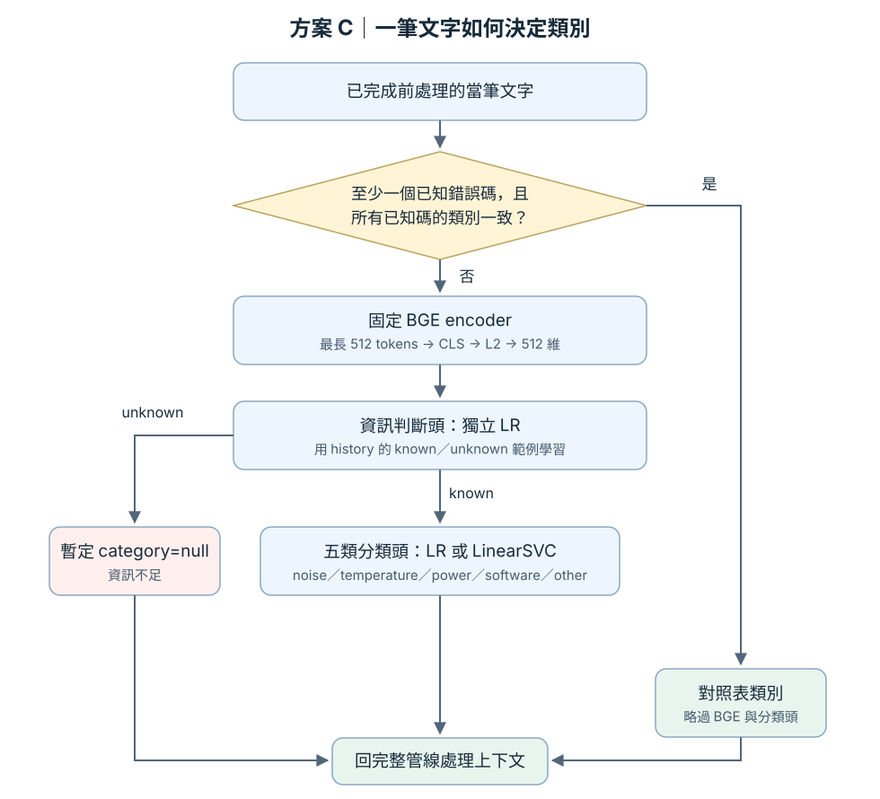
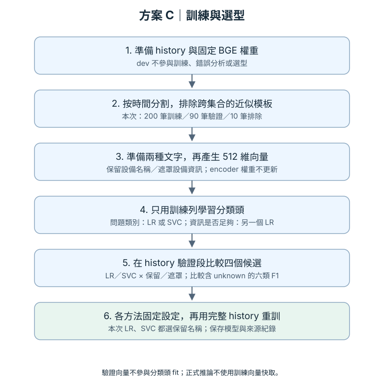
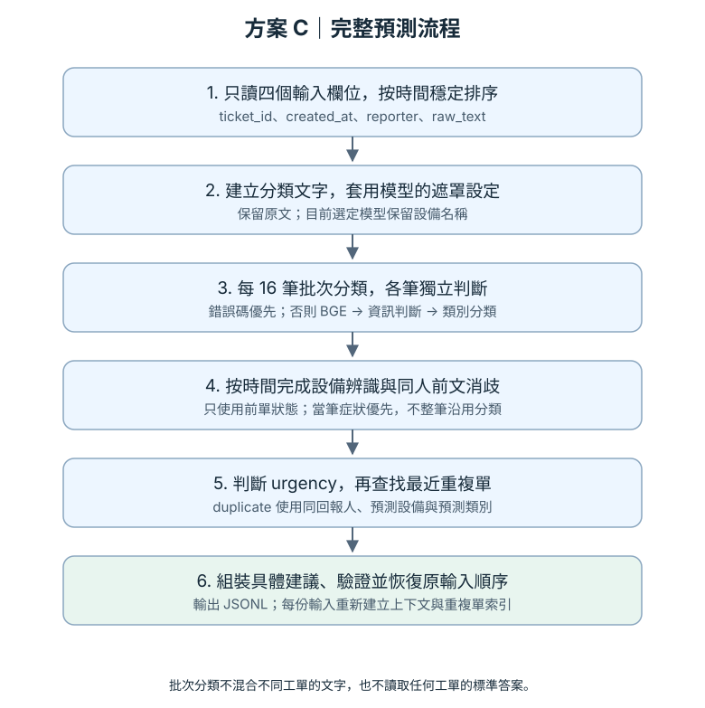

# 方案 C：固定 BGE embedding＋線性分類頭

C 把 B 的字元 TF-IDF 換成預訓練 BGE 向量，保留相同的 LR／LinearSVC 分類頭選項、資訊不足二元模型、公共錯誤碼與其他共用規則。encoder 不微調，工單不送到雲端；模型下載是獨立的事前安裝步驟，正式訓練與推論皆可離線執行。

本頁介紹原有的凍結版；新增的 encoder＋分類頭聯合微調、UI 上傳 history 與時間戳模型保存，請看 [BGE 聯合微調與 UI 訓練](BGE聯合微調與UI訓練.md)。兩種模型保留各自的實驗紀錄，不自動互相替換。

閱讀順序：先看「整體分工」與「一筆工單的分類判斷」，再看訓練、完整預測及實驗結果。以下依目前程式整理，圖中的文字沒有取自 dev 或錯題資料。

## 在 VS Code 預覽流程圖

開啟本檔，按 `⌘⇧V`（macOS）或 `Ctrl+Shift+V`（Windows／Linux），或在命令選單執行 **Markdown: Open Preview**。

本頁三張流程圖使用 Markdown 圖片語法引用 `assets/` 內的 SVG；不需要 Mermaid 擴充套件、網路或降低預覽安全性。移動或分享文件時，請連同 `assets/bge-*.svg` 一起保留。圖檔是可編輯的文字 SVG，修改算法時需同步更新圖與說明。

## 整體分工：哪些由模型判斷？

可以把 BGE 想成「把一段文字轉成一組數字」的工具，再讓小型分類器根據這組數字做判斷。它不產生回覆，也不直接決定設備、急迫性或重複單。

| 元件 | 做什麼 | 是否由 history 訓練 |
|---|---|---|
| BGE encoder | 把當筆文字轉成 512 維向量 | 否，使用固定公開預訓練權重 |
| 資訊判斷頭（LR） | 判斷文字資訊是否足以分類 | 是，使用五類與 null 範例 |
| 問題類別頭（LR 或 SVC） | 在五類問題中選一類 | 是，只使用非 null 標籤 |
| 公共錯誤碼表 | 一致的已知碼可直接決定類別 | 否，依公共對照表 |
| 既有規則與時序狀態 | 設備／上下文、urgency、duplicate、建議 | 不在 C 重新訓練，沿用共用管線 |

這裡的「分類頭」就是接收 BGE 向量的小型分類器。`bge-lr` 與 `bge-svc` 共用同一個 encoder；兩者的資訊判斷頭都使用獨立的 Logistic Regression。

## 一筆工單的分類判斷



1. 先檢查前處理後文字的已知錯誤碼。至少找到一個，且所有可識別的已知碼都指向同一類別，便直接回傳該類別；未知碼不參與這項一致性判斷。
2. 沒有可直接採用的錯誤碼結果時，使用本機 BGE 將文字轉成向量。多個已知碼指向不同類別時，也走這條路，不任選其中一碼。
3. 資訊判斷頭預測 `unknown` 時，暫定 `category=null`；預測 `known` 才交給五類分類頭。
4. 五類為 `noise`（異音）、`temperature`（溫度）、`power`（電力）、`software`（軟體）與 `other`（其他問題）。`other` 是有效類別，與資訊不足的 `null` 不同。

此處沒有用分類信心低於某個門檻直接清空結果；設備不明也不會自動清空分類。圖中是獨立文字分類的結果，完整管線後續仍可能依符合條件的同人前文補充分類，條件見下方「推論流程」。

## 設計重點

- 使用 BAAI/bge-small-zh-v1.5，固定 revision `7999e1d3359715c523056ef9478215996d62a620`；下載資產共 96,377,581 bytes。
- encoder 固定為 CPU、eval、requires_grad=false；取最後一層 CLS，做 L2 正規化，輸出 512 維。分類用途不加入檢索 instruction。
- 長度上限 512 tokens，超出會截斷；batch size=16，PyTorch CPU threads=2，關閉 tokenizer 平行處理。
- 五類分類頭只 fit 有類別的 history 訓練列；獨立二元 LR fit 全部訓練列，處理 known／unknown。仍不將低分類信心直接當成 null。
- 兩方法各比較保留／遮罩設備，C=1、class_weight=balanced，選型指標與 B 一致；沒有依 dev 或結果偏好改選型規則。
- 沿用 A 模組的來源限制仍存在，不能宣稱整條流程完全未受先前 dev 觀察影響。

## 訓練流程



與 B 核對過 history SHA-256、200 筆訓練 ID、90 筆驗證 ID 與排除的 10 筆近似模板 ID，全部相同。預先計算驗證向量不會 fit encoder、分類頭或任何全資料統計；encoder 每張文字獨立運算。完整管線只讓前單預測提供上下文與 duplicate 索引，不讀取 gold 作推論。

分割先以約前 70% 的時間位置建立邊界，同時間邊界的資料全部放入驗證段；再以遮罩設備後的文字相似度建立近似模板群組，從訓練候選排除與驗證同群的資料。因此本次不是隨機抽取 200／90 筆，也不能把近似模板排除誤認為只刪除完全相同的文字。

四個候選為「LR／SVC × 保留／遮罩設備」。各方法依六類 macro-F1 選一種文字設定；同分優先遮罩。這個選型指標包含錯誤碼與資訊判斷，尚未加入完整管線的上下文修正。設定固定後才用完整 history 重訓，並保留各候選與選定模型。

## history 內部結果與取捨

下表為同一組 90 筆的內部驗證；不是 dev，也不是完整 history 重訓後的訓練集回測。

| 候選 | 五類分類頭 F1 | 加入資訊判斷／錯誤碼後 category F1 | 六類 F1（選型） | unknown recall | 四欄加權總分 |
|---|---:|---:|---:|---:|---:|
| BGE＋LR，保留名稱 | 0.793935 | 0.793935 | 0.805729 | 0.80 | 0.819868 |
| BGE＋LR，遮罩名稱 | 0.891957 | 0.888795 | 0.761414 | 0.20 | 0.880297 |
| BGE＋SVC，保留名稱 | 0.897928 | 0.897928 | 0.891131 | 0.80 | 0.874798 |
| BGE＋SVC，遮罩名稱 | 0.948493 | 0.946756 | 0.809921 | 0.20 | 0.914329 |

**兩方法選定保留設備名稱的版本。** 遮罩版的五類分類分數較高，但資訊不足辨識較差。原先固定的六類 macro-F1 讓 unknown 與五類故障各占相同比重，因此選到保留名稱版；沒有事後改用四欄總分或單看 category 來選擇更好看的結果。

驗證段只有 5 筆 null，unknown recall 的變化不能當作穩健結論。設備文字的存在也可能成為資料集特有的捷徑，保留名稱版是否泛化仍須固定版本的新資料驗證。

與 B 的既有選定版本對照：LR 的內部分類 F1 從 0.746499 到 0.793935；SVC 從 0.752058 到 0.897928。這是相同 history 分割、各方法依同一準則選定版本後的觀察；B 選遮罩、C 選保留，因此不能把差異全歸因於 encoder 這唯一變因。不能直接宣稱未知資料也有同樣提升，或拿 UI 的完整 history 回測分數替代。

完整 history 重訓後，預設頭檔為 `models/bge-lr.joblib`（24,720 bytes）與 `models/bge-svc.joblib`（24,762 bytes），兩者共用 encoder。其他 raw／masked 候選也保留；分類頭檔案大小不含 encoder，不能誤稱整個 C 只有約 25 KB。

正式訓練紀錄：`reports/training-c/20261113T074118Z-a3ede3e5/`；第一次試跑仍留存，但本頁使用最後固定版本。所有向量、權重、metadata、錯題與預測只留本機，不加入 Git。

## 推論流程



分類向量可預先處理，但 encoder 不混合不同工單的內容，也不使用回報人前文、未來工單答案或輸入標籤。批次分類的結果再接回原有時序狀態；每份輸入重設狀態。

| 階段 | 目前的判斷方式 |
|---|---|
| 輸入 | 只投影 `ticket_id / created_at / reporter / raw_text`；其他欄位不交給算法 |
| 文字 | 原文保留；分類文字先正規化並移除特定簽名段；urgency 另用原文建立比對視圖 |
| 分類 | 批次預先計算當筆文字的類別；目前選定模型不遮罩設備名稱 |
| 設備／上下文 | 由名稱、別名、型號、錯誤碼與位置產生候選；符合指涉且候選不衝突時，才用同人前單消歧 |
| 前文分類 | 只有明確指涉同一問題、設備一致且當筆沒有新症狀等條件成立時才參考前單；不整筆沿用 |
| urgency | 設備／分類判斷後，依六條優先規則決定 `high / normal / low` |
| duplicate | 使用「同回報人＋預測設備＋預測類別」的最近前單；設備或類別為 null 不建立索引 |
| 建議／輸出 | 組合當筆原文片段與處置模板，完成輸出驗證，再恢復原輸入順序 |

上下文與 duplicate 僅讀取已處理的前單預測，不使用標準答案。相同時間維持原行序；詳細共用規則見 [方案 A 演算法流程](演算法流程.md)，C 並未以 BGE 取代這些規則。

**批次計時不冒充逐筆獨立推論。** 每筆 `seconds` 記「所在分類批次的完整服務時間＋該筆其餘規則時間」，並另存 `batch_classification_seconds`。同批成員共享該批時間，程序總時間只計一次，所以不能把逐筆 seconds 相加當成總時間，也不能把這個 P95 與 B 的逐筆獨立分類延遲直接比較。載入、共同前處理、排序與寫檔仍計入外部程序總時間；它們未藏在快取命中時間之外。

訓練比較可以用固定向量快取評估分類頭；正式 CLI 推論不使用訓練快取，冷啟動量測會真正載入並執行 encoder。沒有生成式模型，因此 llm_used=false。

## 安裝、訓練與使用

在專案根目錄執行：

```bash
python3 -m venv .venv
.venv/bin/python -m pip install -r Solution/requirements-embedding.txt
# 唯一需要連網的模型安裝步驟；只下載公開權重，不上傳工單。
.venv/bin/python Solution/scripts/download_encoder.py --revision 7999e1d3359715c523056ef9478215996d62a620

HF_HUB_OFFLINE=1 TRANSFORMERS_OFFLINE=1 .venv/bin/python Solution/train_embedding.py
.venv/bin/python predict.py data/tickets.jsonl Solution/predictions/bge-lr_tickets.jsonl --method bge-lr
.venv/bin/python predict.py data/tickets.jsonl Solution/predictions/bge-svc_tickets.jsonl --method bge-svc
.venv/bin/python Solution/scripts/test_development.py
```

模型只從本機載入，local_files_only=true、trust_remote_code=false、safetensors 權重；下載資產逐檔驗證雜湊，分類頭驗證方法、sklearn 版本、檔案雜湊與 encoder revision。只載入自己訓練的可信 joblib。自訂 `--model-path` 時，encoder 子資料夾必須與頭檔相鄰；不能只搬移頭檔就期待另一台主機重現。

UI 已提供「方案 C · BGE＋Logistic Regression／LinearSVC」，本機使用 .venv，2 GB 使用獨立映像：

```bash
docker build -f Solution/Dockerfile.embedding -t silab-fa:scheme-c .
.venv/bin/python Solution/scripts/run_budget.py --method bge-lr --probe
.venv/bin/python Solution/scripts/run_budget.py --method bge-svc
```

Docker 安裝 CPU 專用 PyTorch，不攜帶不需要的 CUDA runtime。執行時禁止拉取映像與容器連網，仍需查驗實際 memory.max／swap。實測見 [bench.md](../bench.md)、[budget.md](../budget.md)。dev 僅供版本固定後驗證，本次不觀察或使用其內容設計 C。

## 模組與依據

| 位置 | 職責 |
|---|---|
| `triage/embedding.py` | 本機 CPU encoder、批次分類與 C 資產載入 |
| `training/linear.py` | B/C 共用的分類頭與資訊判斷頭 fit |
| `training/evaluation.py` | B/C 共用的 history 選型指標 |
| `train_embedding.py` | 固定向量、四候選比較、先固定設定再重訓 |
| `scripts/download_encoder.py` | 明確的事前下載、revision 與雜湊保存 |
| `triage/pipeline.py` | 分類結果與設備／上下文、urgency、duplicate 的時序組裝 |
| `docs/assets/bge-*.svg` | 本文件的三張流程圖；可直接在 VS Code Markdown 預覽顯示 |

模型、CLS pooling、正規化與非檢索用途不加 instruction 的依據：[BAAI 官方 BGE 模型卡](https://huggingface.co/BAAI/bge-small-zh-v1.5)。資產與分類頭的保存限制參考 [scikit-learn 模型保存文件](https://scikit-learn.org/stable/model_persistence.html)。
