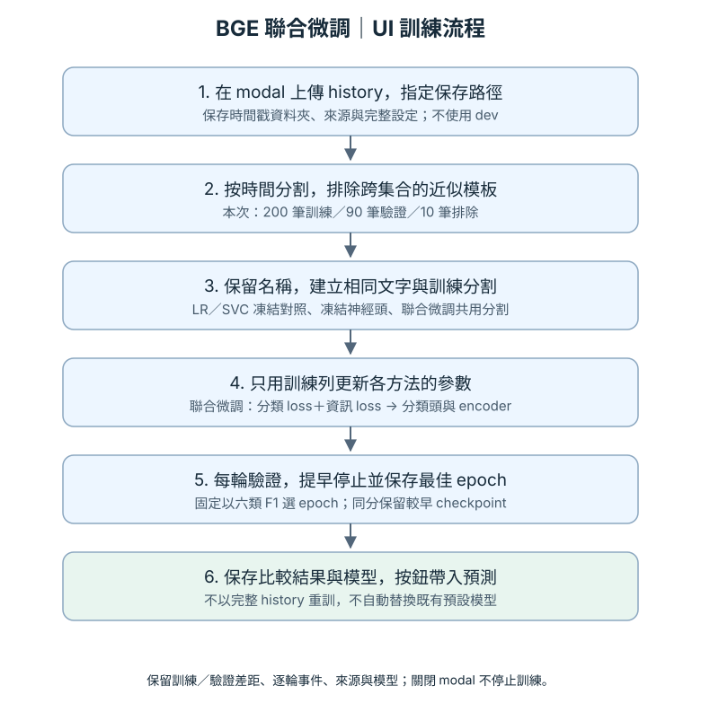

# BGE 聯合微調與網頁訓練

> 2026-11-14：操作入口已改為獨立「模型訓練」頁，新增 CPU／CUDA GPU／Modal 與 batch 進度；本頁下方的數字是既有 CPU 實驗紀錄，不代表新增後端已通過實機驗證。最新操作見 [訓練頁與運算環境](訓練頁與運算環境.md)。

現在可以從工作台右上角的「訓練模型」開啟 modal，上傳開發用 history、調整保守設定、指定保存根目錄，並在同一個視窗查看進度與比較結果。訓練在本機背景程序執行，不會將工單或模型上傳雲端。

這次新增的是 **BGE encoder＋神經分類頭一起微調**：history 的分類標籤會透過 loss 反向傳播，更新 encoder 的全部參數與分類頭。既有 [凍結 BGE＋LR／SVC](BGE方案C方法與實驗.md) 保留供比較，沒有改寫成另一種預設模型。

## 從 UI 操作

1. 啟動 `.venv/bin/python helper_tool/ui_server.py`，開啟工作台，按「訓練模型」。依賴與公開 BGE 權重需事先安裝，訓練不會自行下載。
2. 選擇「BGE encoder＋分類頭聯合微調，與凍結版比較」。另外兩個選項可觸發既有 TF-IDF 或凍結 BGE 的四候選訓練流程。
3. 使用專案 `data/history.jsonl`，或選擇上傳 history。每筆須有 `ticket_id / created_at / reporter / raw_text / category`；category 為五類之一或 null。時間須包含時區，ID 不可重複。
4. 指定保存根目錄，例如 `Solution/models/training-runs` 或本機其他路徑。按下「開始訓練與保存」後，自動建立台北日期時間戳與唯一編號的子資料夾。
5. modal 可關閉後再開啟，也可重新整理頁面。紀錄從本機讀取，背景訓練仍會繼續。同專案同時只允許一個訓練工作，跨兩個 UI 服務也共用鎖。
6. 成功後在紀錄中按「finetuned → 帶入預測」，會自動填入方法及模型路徑。凍結 LR／SVC、凍結神經頭也可各自帶入。沒有自動覆寫原本預設模型。

上傳目前限 8 MB、最多 2,000 筆，以符合目前小資料工作流程。分割後的訓練段須涵蓋五類與 null，且每類至少 2 筆；驗證段須同時有已知類別與 null。資料不足會明確失敗並保留紀錄，不會拿驗證資料補入訓練。

**dev 僅供固定版本驗證。** UI 要求確認資料是 history，並拒絕含 dev 的上傳檔名；這不能辨認被改名的 dev。資料來源仍由使用者確認，不能藉改名把保留集送入訓練。沿用 A 模組曾受 dev 觀察影響的來源限制仍適用，見 [AGENTS.md](../../AGENTS.md)。

## 同一份資料如何比較



先按時間切分 history，再排除與驗證段同屬近似模板群組的訓練資料；與既有 B/C 共用 `history_split()`。這次 300 筆 history 分為 200 筆訓練、90 筆驗證、10 筆排除。特徵只來自當筆文字；目前比較固定保留設備名稱，最長 512 tokens。

| 比較方法 | Encoder | 分類頭 | 資訊不足模型 |
|---|---|---|---|
| bge-lr | 凍結 | 既有 sklearn Logistic Regression，C=1 | 既有二元 LR |
| bge-svc | 凍結 | 既有 sklearn LinearSVC，C=1 | 既有二元 LR |
| frozen-neural | 凍結 | PyTorch 線性頭＋dropout | 同架構的二元線性頭 |
| finetuned | **全部參數更新** | 與 frozen-neural 相同 | 同架構的二元線性頭 |

後兩組使用相同初始頭設定、seed、資料順序、batch、loss 與選 epoch 規則，分別選出自己的最佳 epoch；控制組的 encoder 在 eval 模式且不更新。這能協助區分「換了分類頭」與「更新 encoder」的差異。sklearn 頭與神經頭的最佳化方式不同，不能把 LR／SVC 對微調的差值全歸因於 encoder。

已知錯誤碼優先、資訊不足判斷、上下文、設備、urgency、duplicate 與建議沿用共用管線。報告同時保存獨立文字分類指標及完整四欄管線分數；兩者的範圍不同。訓練 loss 不使用錯誤碼表的預測作標籤，而是直接使用 history 的真實分類標籤。

## 小資料的保守設定

以下是本次固定起點，並非已證明最佳或保證不過擬合的參數。UI 提供有限範圍調整，所有實際值會存入設定與模型 metadata。

| 設定 | 預設 | 用途與限制 |
|---|---:|---|
| Encoder learning rate | 0.00001 | 降低預訓練表示一次被大幅改動的風險；可設 0.000001～0.00005 |
| 分類頭 learning rate | 0.001 | 新增的頭使用較大的學習率；可設 0.0001～0.01 |
| 最多 epochs | 5 | 須為大於等於 1 的整數，不設 10 輪上限；提早停止仍適用 |
| AdamW weight decay | 0.01 | 參數正規化；encoder 的 bias／LayerNorm weight 不衰減 |
| 分類頭 dropout | 0.2 | 訓練時隨機忽略部分輸入；範圍 0.1～0.5，推論關閉 |
| 五類 label smoothing | 0.1 | 降低對單一分類標籤過度自信；範圍 0～0.2 |
| 提早停止 | patience=2 | 驗證六類 macro-F1 連續兩輪未改善超過 0.0001 即停止 |
| 最佳 checkpoint | 六類 macro-F1 | 同分保留較早 epoch，包含 unknown，不事後改用較好看的總分 |
| Batch size／CPU threads | 8／2 | 固定預設；使用 CPU float32，沒有 GPU 或混合精度 |
| Warmup／衰減 | 10% steps／線性 | 逐步增加再減少學習率；排程與最多 epochs 一起記錄 |
| Gradient clipping | norm=1.0 | 限制梯度大小；不替代驗證或正規化 |
| Seed | 42 | 保存固定初始設定；單一 seed 的結果不代表穩健性 |

保留 BGE 的 CLS pooling 與 L2 正規化。神經模型同時學兩件事：

- 五類頭：只對 category 非 null 的訓練列計算加權 cross-entropy，包含 label smoothing。
- 資訊頭：全部訓練列計算 known／unknown 的加權 cross-entropy；null 為 unknown。

總 loss 為「五類 loss＋0.5 × 資訊 loss」。類別權重只由訓練段頻率計算；某個 batch 全是 null 時仍可訓練資訊頭及 encoder，不會除以零或跳過整個 batch。判斷 null 使用資訊頭 argmax，沒有在驗證集搜尋分類信心門檻。

每個 epoch 保存 train loss、訓練／驗證的分類與六類 F1、unknown 指標、單輪耗時。訓練 F1 明顯高於驗證 F1、或訓練持續改善而驗證轉差，都是需要關注的訊號；UI 提供並列數字，但不因一次差距就自動調參。

## 紀錄與模型保存

```text
指定的保存根目錄/
└── YYYYMMDD-HHMMSS-ffffff-唯一編號/
    ├── .gitignore                 本次資料夾全部忽略，避免自訂路徑誤加入 Git
    ├── config.json                實際參數、來源名稱、筆數與建立時間
    ├── data/history.jsonl         本次開發資料快照，不覆寫專案 history
    ├── source/                    啟動時的相關程式、規則與依賴快照
    ├── status.json                queued／running／succeeded／failed／interrupted
    ├── worker.log                 程序輸出與完整錯誤堆疊
    ├── events.jsonl               逐階段與逐 epoch 事件
    └── models/
        ├── comparison.json        分割 ID、資料／原碼雜湊、版本、比較指標
        ├── frozen/                本次 train-only 的 LR、SVC 與固定 encoder
        ├── frozen-neural/         凍結 encoder＋神經頭的最佳 checkpoint
        ├── finetuned/             聯合微調的最佳 checkpoint
        │   ├── encoder/           tokenizer、safetensors、設定與逐檔雜湊
        │   ├── heads.safetensors  五類頭與資訊頭
        │   └── model.json         類別順序、設定、最佳 epoch 與頭檔雜湊
        ├── *-epochs.json          完整逐輪紀錄
        └── *-evaluation/          history 驗證的彙總與錯題報告
```

聯合微調流程保留 **僅用訓練段 fit 的最佳 checkpoint**，不再用完整 history 重訓。這樣 UI「帶入預測」實際載入的模型，就對應報告中的 checkpoint。驗證段已用來選 epoch，這仍是選型驗證，不能宣稱獨立測試；若在完整 history 再跑一次，分數也會混入訓練資料，不能替代這份比較。

既有 TF-IDF／凍結 BGE 四候選選項保留原先行為：先用 history 內部分割比較，再用完整 history 重訓保存，因此其最終權重與選型驗證權重不同。UI 與本文件明確區分這兩種訓練流程。

工作索引保存在 `helper_tool/reports/training/`，UI 列出最近 50 筆，沒有自動刪除舊紀錄或模型。失敗不顯示為成功，已保存的 log／部分產物保留供檢查；不提供從失敗 checkpoint 自動續訓，重試會建立新工作。正常重啟 UI 不停止已啟動 worker；若 worker 異常消失，下次讀取時標記中斷。索引及來源資料夾皆需保留，刪除或搬走模型後不能期待舊按鈕仍可使用。

## 首輪實測結果

固定預設設定，未用 dev 訓練、選型或調參。同一份 history 內部分割：

| 方法 | 分類 macro-F1 | 六類 macro-F1 | unknown recall | 四欄總分 | 最佳 epoch |
|---|---:|---:|---:|---:|---:|
| 凍結 BGE＋LR | 0.793935 | 0.805729 | 0.80 | 0.819868 | 不適用 |
| 凍結 BGE＋SVC | 0.897928 | 0.891131 | 0.80 | 0.874798 | 不適用 |
| 凍結 BGE＋神經頭 | 0.686637 | 0.553206 | 0.00 | 0.746521 | 5 |
| BGE＋神經頭聯合微調 | 0.792377 | 0.639588 | 0.00 | 0.806484 | 4 |

聯合微調確實比相同神經頭的凍結控制組高，但目前仍不及既有凍結 SVC，且兩組神經模型未辨識出驗證段的資訊不足案例。驗證段只有 5 筆 null，這個結果不能證明未知資料的穩健性。本次沒有根據這份結果再調參或自動把聯合微調設成預設。

程序另外核對 encoder embedding 權重在訓練前後是否改變：凍結控制組應不變，聯合微調應改變。這是「真的有更新 encoder」的實作證據，不是效果變好的保證。

首輪本機紀錄：`models/training-runs/20261113-165443-713113-bfded6ec/`；這是 source 快照功能加入前的首輪，保有來源雜湊。後續由 UI 建立的工作會保存 source 快照。未執行微調訓練的 2 GB 演練；此處的訓練為本機未限制記憶體，不能套用凍結版的既有訓練／推論資源結論。

UI 上傳與完整流程驗證紀錄為 `models/ui-training-runs/20261113-170016-746138-98379b7c/`：確認關閉 modal 後仍完成訓練，並可從紀錄帶入保存的 checkpoint。此輪同樣在 source 快照功能加入前啟動；結果與首輪一致。該 checkpoint 已透過 UI 在 2 GB、禁止 swap、2 CPU 下完成 2,000 筆推論：子程序 25.595 秒、UI 總處理時間 26.100 秒、cgroup memory.peak 約 445.79 MiB、退出 0、OOM 計數 0。這是一次推論 smoke test，不是 2 GB 訓練驗證，也不是三次正式效能比較；tickets 沒有標籤，未計算分數。證據位於 `helper_tool/reports/ui/20261113-170347-90157c4c/`。

加入 source 快照後，另經 API 實際完成 TF-IDF 與凍結 BGE 的四候選訓練，確認時間戳模型、比較報告及程式快照皆保存成功。開發測試共 62 項，60 項通過、2 項 dev 驗證預設略過；JavaScript 語法與 diff whitespace 檢查通過。本次未開啟 dev 或其逐筆衍生資料。

## 使用保存的 checkpoint 預測

UI 可直接帶入；命令列可使用：

```bash
.venv/bin/python predict.py data/tickets.jsonl Solution/predictions/finetuned.jsonl \
  --method bge-finetuned \
  --model-path Solution/models/training-runs/某次時間戳/models/finetuned
```

`frozen-neural` 也用同一個 `bge-finetuned` 載入介面，但 metadata 的 variant 會保留它是凍結控制組；方法名稱代表神經模型格式，不表示所有載入的 encoder 都經過微調。LR／SVC 則沿用原方法並指定該次 `.joblib`。載入驗證類別順序、頭檔與 encoder 逐檔雜湊；只使用本機資產。

模型路徑可用在本機預測，也可透過 UI 的 2 GB 容器以額外唯讀 mount 帶入；Docker 需已啟動並有 `silab-fa:scheme-c` 映像。是否能在 2 GB 內完成仍應以該模型的實測為準，訓練 modal 不會施加 2 GB 上限。

## 程式對照與參考

| 檔案 | 職責 |
|---|---|
| `helper_tool/training_jobs.py` | 驗證上傳、時間戳資料夾、背景程序與跨服務鎖、歷史查詢 |
| `Solution/train_finetune.py` | Worker 狀態、事件與失敗記錄，轉交各訓練方式 |
| `Solution/training/settings.py` | UI／worker 共用的設定預設與上下界驗證 |
| `Solution/training/finetuning.py` | 相同分割的四方法比較、聯合梯度、提早停止與 checkpoint |
| `Solution/triage/neural.py` | 神經頭、safetensors 載入與既有推論管線適配 |

最佳化與 loss 的 API 依據：[Hugging Face 微調文件](https://huggingface.co/docs/transformers/training)、[PyTorch CrossEntropyLoss](https://docs.pytorch.org/docs/stable/generated/torch.nn.CrossEntropyLoss.html)。上表的具體數值是本專案保守的實驗起點，並非官方文件對這份資料的保證。
