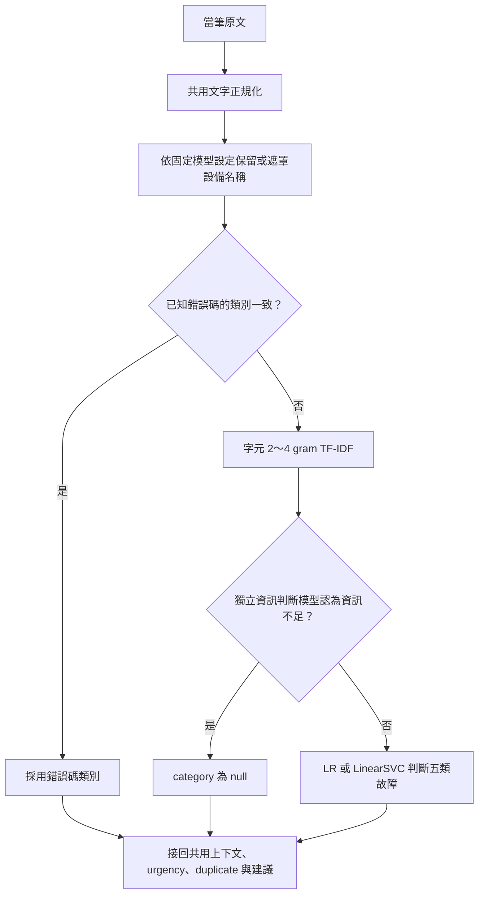

# 方案 B：字元 TF-IDF 與兩種線性分類器

若要先理解方法概念與判斷順序，請先看 [字元 TF-IDF 分類方法說明](字元TF-IDF分類方法說明.md)。本頁保留實作設定、實驗數字與重現指令。

目前已實作 Logistic Regression（`tfidf-lr`）與 LinearSVC（`tfidf-svc`），兩者都可從 CLI、UI 與 2 GB 容器執行。根目錄兩參數入口預設仍為方案 A，沒有自動切換方法。

## 文字如何變成判斷？

例如「登不進去」會拆成相鄰的 2～4 字片段。TF-IDF 將各片段轉成數值特徵，再交給線性分類器。詞彙表與 IDF 只從訓練資料學習，驗證與正式推論只做 transform。



五類分類器只用 history 有類別的資料訓練。history 的 null 範例用來訓練另一個二元 Logistic Regression，區分「可判斷／資訊不足」，沒有把 null 當 other，也沒有把五類分類器的低信心直接當 null。這個資訊判斷仍會犯錯，不代表模型能保證辨識所有資訊不足情境。

B 取代 A 的症狀詞分類器，保留公共錯誤碼查表；設備、正規化、上下文、urgency 與 duplicate 繼續共用。這些既有模組曾在 A 開發前期受 dev 觀察影響，因此**只能宣稱本次模型訓練與選型未使用 dev，不能宣稱整條流程完全未受 dev 影響**。

## 如何比較而不觀察 dev？

訓練入口只接受固定的 `data/history.jsonl`，沒有任意指定 dev 的參數。

1. 按時間排序 history，後 30%（90 筆）作內部驗證。
2. 對遮罩設備後的文字，以 SequenceMatcher ≥0.90 建立近似模板群組，包含傳遞關係；不使用標籤分群。
3. 若前段工單所在群組也出現在後段，將該筆從訓練移除。此次移除 10 筆，剩下 200 筆訓練。
4. 詞彙表、IDF、五類分類頭與資訊判斷頭，都只在這 200 筆 fit。
5. 固定比較 LR／SVC × 保留／遮罩設備四種設定。C=1，class_weight=balanced，沒有額外搜尋超參數。
6. 依「五類＋unknown 的六類 macro-F1」選擇各方法的文字版本，同分優先遮罩；先保存選擇，再以完整 history 300 筆重訓四個資產，供正式推論。

分群會看 history 驗證段的文字以避免近似模板跨界，但不會用它 fit 特徵或模型。這只排除該相似度規則能抓到的重複，不能保證完全消除所有同義模板。反覆使用這個內部切分選型，也不能把分數當成未知資料的無偏估計。

## history 內部結果

以下只評估同一組 90 筆；不是 dev 分數，也不是完整 history 重訓後的訓練集分數。

| 方法 | 設備名稱 | 五類分類頭 F1 | 加入資訊判斷／錯誤碼後的分類 F1 | 六類 F1（選型用） | 完整管線四欄總分 |
|---|---|---:|---:|---:|---:|
| Logistic Regression | 保留 | 0.691208 | 0.698131 | 0.612583 | 0.786027 |
| Logistic Regression | 遮罩 | 0.742929 | 0.746499 | 0.654870 | 0.800893 |
| LinearSVC | 保留 | 0.706675 | 0.714531 | 0.625864 | 0.792587 |
| LinearSVC | 遮罩 | 0.748142 | 0.752058 | 0.659440 | 0.805264 |

兩方法均選擇遮罩版，分別保存為 `models/tfidf-lr.joblib` 與 `models/tfidf-svc.joblib`。SVC 在這次切分略高，尚不足以證明普遍優於 LR，兩者都保留供後續固定版本驗證。

遮罩版資訊不足 recall 為 0.20，驗證段僅 5 筆 null，這是明確限制。其他欄位共用，LR／SVC 的完整管線結果分別為：

| 方法 | category | device | urgency | duplicate |
|---|---:|---:|---:|---:|
| LR 遮罩 | 0.746499 | 0.888889 | 0.989245 | 0.633333 |
| SVC 遮罩 | 0.752058 | 0.888889 | 0.989245 | 0.644068 |

計算完整管線時，按時間推論整份 history，僅以後段 90 筆計分。前段包含被移出訓練的工單仍可提供過去的預測上下文及 duplicate 索引，不讀取其 gold 作推論；沒有讓驗證工單參考未來。這保留原始 duplicate 的「最近前單」定義，沒有重寫標準答案。

此次未讀取 dev 內容、未執行 dev 驗證。本機目前未提供 dev，未填造其分數。訓練與選擇紀錄在 `reports/training/20261113T031746Z-785f729a/`，含版本、程式與 history 雜湊、分割 ID、候選結果、history 錯題及資產資訊；不加入 Git。

## 安裝與重現

在專案根目錄執行：

```bash
python3 -m venv .venv
.venv/bin/python -m pip install -r Solution/requirements-ml.txt
.venv/bin/python Solution/train.py

.venv/bin/python predict.py data/tickets.jsonl Solution/predictions/tfidf-lr_tickets.jsonl --method tfidf-lr
.venv/bin/python predict.py data/tickets.jsonl Solution/predictions/tfidf-svc_tickets.jsonl --method tfidf-svc

.venv/bin/python Solution/scripts/test_development.py
```

`--model-path` 可選擇其他本機資產，例如 `Solution/models/tfidf-lr-raw.joblib`。只載入自己產生的可信 joblib 檔案；joblib 並非安全的任意檔案格式。載入時檢查方法、scikit-learn 版本及檔案雜湊；缺模型或依賴會明確報錯，不會偷偷退回 A。

四個模型以完整 history 重訓，其中 282 筆有類別、18 筆 null。模型及 metadata、虛擬環境、預測與逐筆報告都只留本機；另一台電腦應按上述命令重建。推論時不讀取 history 標籤，也不需連網。

UI 方法選單已加入兩個選項。本機 ML 方法優先使用專案 `.venv/bin/python`；若未建立 .venv，則使用啟動 UI 的 Python，仍需安裝 ML 依賴。UI 預設 history，開啟頁面不掃描 dev 內容；只有明確選 dev 且檔案存在時才執行固定版本驗證。

2 GB 需要另建 ML 映像：

```bash
docker build -f Solution/Dockerfile.ml -t silab-fa:scheme-b .
.venv/bin/python Solution/scripts/run_budget.py --method tfidf-lr --probe
.venv/bin/python Solution/scripts/run_budget.py --method tfidf-svc
```

資源量測見 [bench.md](../bench.md) 與 [budget.md](../budget.md)。`run_budget.py` 現在預設使用 history 作可執行性檢查，不是準確率驗證；dev 必須在版本固定後明確指定 `--validation-dataset dev`。

## 模組位置與來源

| 職責 | 位置 |
|---|---|
| history 載入、時間與模板分割 | `training/data.py` |
| TF-IDF 與兩個分類頭 fit | `training/linear.py` |
| 實驗比較、先固定設定再重訓 | `train.py` |
| 模型推論與資產保存／載入 | `triage/linear.py` |
| 方法選擇與延遲載入依賴 | `triage/factory.py` |
| 共用分類器契約 | `triage/classification.py` |

方法依據：[scikit-learn 特徵抽取](https://scikit-learn.org/stable/modules/feature_extraction.html)、[避免資料洩漏](https://scikit-learn.org/stable/common_pitfalls.html)、[模型保存注意事項](https://scikit-learn.org/stable/model_persistence.html)。實際依賴固定為 requirements-ml.txt 的版本，未以文件中的其他分類器擴大實驗範圍。
