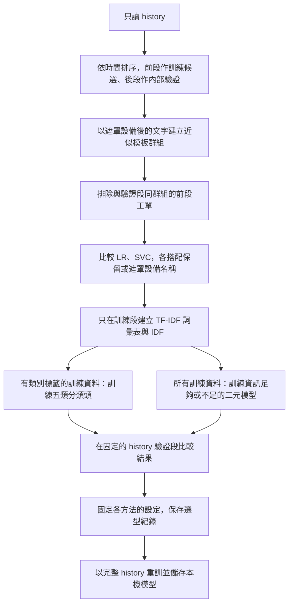
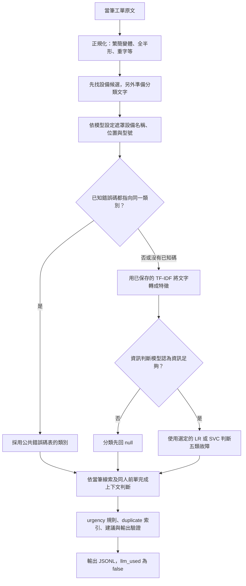

# 字元 TF-IDF＋Logistic Regression／LinearSVC：方法說明

這份文件用白話介紹目前的方案 B。想查實驗數字、安裝指令與程式位置，請接著看 [TF-IDF 實作與比較](TF-IDF實作與比較.md)。

## 先掌握五個重點

1. **主要替換故障分類。** 設備解析、上下文、急迫程度和重複報修仍走共用流程。
2. **文字先轉成數字特徵。** 不需要斷詞服務或生成式模型，使用相鄰 2～4 個字的片段。
3. **比較兩種分類方法。** Logistic Regression 與 LinearSVC 都從有標籤的 history 學習分類。
4. **資訊不足另外判斷。** 用獨立二元模型決定是否回 null，不把「五類模型信心低」直接當成資訊不足。
5. **開發只用 history。** dev 僅供版本固定後驗證，不用來設計、挑選或調整算法。

## 一、TF-IDF 在做什麼？

分類器需要數字，不能直接把一整句中文當成輸入向量。字元 TF-IDF 會先拆片段，再依訓練資料中的出現情況計算權重。

以示意文字「登不進去」為例：

| 片段長度 | 拆出的特徵 |
|---|---|
| 2 個字 | 登不、不進、進去 |
| 3 個字 | 登不進、不進去 |
| 4 個字 | 登不進去 |

一個片段在某張工單出現多少次，以及在多少張訓練工單出現，都會影響數值。普遍出現的片段相對不容易獲得高 IDF；最後再將整張工單的向量做長度正規化。

**TF-IDF 本身不看分類答案。** 它負責表示文字；哪些特徵支持 noise、power 等類別，交給後面的監督式分類器學習。

使用字元片段可以避免依賴中文斷詞，部分字被打錯時也可能保留其他片段；但沒有看過的措辭或嚴重缺字仍可能判錯，不能視為完整的語意理解。

## 二、LR 與 LinearSVC 差在哪裡？

| 方法 | 簡單理解 | 目前輸出 |
|---|---|---|
| Logistic Regression（LR） | 從已標記案例學習各類別的特徵權重，選擇模型認為較可能的類別 | 五類之一 |
| LinearSVC | 學習區分類別的線性界線，重視分類間隔 | 五類之一 |

兩者使用相同的字元 TF-IDF 設定、history 分割與其他共用模組，便於比較。LR 在本專案使用 `predict` 取得類別；介面沒有輸出其機率，也沒有把 SVC 的分數當作機率。

五類是 `noise / temperature / power / software / other`。**other 代表有明確問題但屬於其他類；null 代表資訊不足。** 因此 null 不直接放進這個五類分類頭。

## 三、訓練與選型流程圖

這次分割得到 **200 筆訓練、90 筆內部驗證，另排除 10 筆跨分割近似模板**。分群只用文字，不用答案；驗證段不參與詞彙表、IDF 或模型的 fit。

比較共有四個候選：LR 保留名稱、LR 遮罩名稱、SVC 保留名稱、SVC 遮罩名稱。依「五類加 unknown 的六類 macro-F1」選擇各方法的版本；兩方法本次都選遮罩版。

這個六類指標只用於 history 內部選型，與題目四欄加權總分不同。選型成績來自切分後的模型；正式推論使用後來以完整 history 重訓的模型，不能把兩者混稱同一份權重的驗證分數。

## 四、一張工單進來時怎麼判斷？

設備名稱遮罩只影響分類用文字，不會刪除原文或設備解析的證據。例如分類時不應只因出現「冷凍櫃」，就猜成溫度故障。

如果錯誤碼表沒有該代碼，就不採用查表捷徑；多個已知碼若指向不同類別，也交回文字分類流程。推論只載入固定模型並轉換文字，不會邊測試邊重新訓練。

## 五、為什麼資訊不足要獨立處理？

「不知道屬於哪一類」與「回報內容根本沒有足夠資訊」是不同問題。五類模型分數接近，也可能只是這張單有多種症狀，不代表應直接丟掉分類。

目前另外用一個 Logistic Regression，從 history 中有類別與 null 的案例學習資訊判斷：

- 判為資訊足夠：交給五類分類頭。
- 判為資訊不足：先回 null，再交給既有上下文規則判斷是否有明確的同問題指涉可補充。

這個二元模型本身也會錯。history 的 null 範例少，是目前重要限制；它無法保證將所有資訊不足案例正確攔下。

## 六、模型換了，哪些規則仍相同？

| 項目 | 目前處理方式 |
|---|---|
| 設備 | 名稱、別名、型號、位置、錯誤碼與必要上下文 |
| 故障分類 | 公共錯誤碼優先；其餘使用資訊判斷模型與 TF-IDF 分類器 |
| urgency | 仍依題目六條規則順序，不讓分類器自由判斷急迫性 |
| duplicate | 同人、同預測設備、同預測類別的最近前單 |
| 建議 | 當筆原文片段搭配處置模板 |

分類改變會影響 duplicate，因此不能只看分類分數；完整管線的四欄結果也要一起驗證。

## 七、資料邊界與目前限制

本次新增模型只用 history 訓練與選型，沒有讀取 dev 內容。dev 只允許在版本固定後驗證，不能把錯題或分數拿回來調整設計。

不過，共用的正規化、設備別名與上下文等模組來自方案 A，曾受先前觀察 dev 的影響。**因此不能把整條 B 流程宣稱為完全未觀察 dev 的獨立開發結果。** 詳見 [AGENTS.md](../../AGENTS.md)。

此外，history 內部切分規模有限、近似模板排除不可能涵蓋所有同義說法，LR／SVC 的小幅分數差異也不足以證明某方法在未知資料上一向較好。

## 八、想實際使用時

UI 選擇「方案 B · TF-IDF＋Logistic Regression」或「方案 B · TF-IDF＋LinearSVC」，再指定測試資料、環境和輸出資料夾即可。模型、預測與逐筆報告只留本機。

安裝、訓練與命令列操作見 [TF-IDF 實作與比較](TF-IDF實作與比較.md)；效能見 [bench.md](../bench.md)，2 GB 限制驗證見 [budget.md](../budget.md)。
