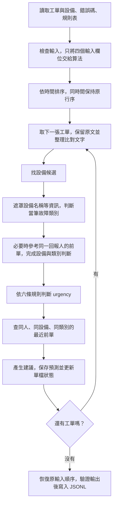
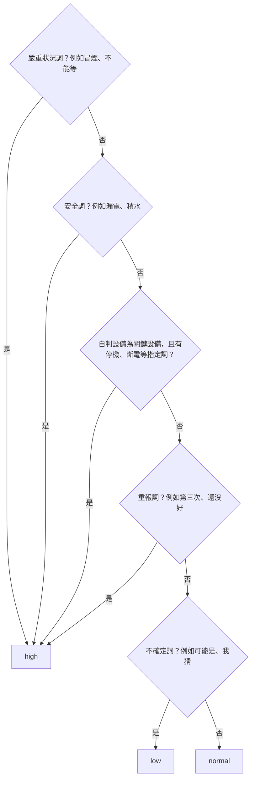

# 方案 A 的演算法怎麼判斷工單？

本頁介紹預設的 **方案 A：規則版**。可以把它想成一位依照檢查表工作的分流人員：先找設備和症狀，再決定急迫程度、檢查是否重複報修，最後寫出處置建議。整個流程在本機執行，沒有呼叫 LLM。另已提供 [方案 B：TF-IDF 分類流程](TF-IDF實作與比較.md)。

每張工單會得到四項判斷：

| 欄位 | 要回答的問題 |
|---|---|
| `device_id` | 哪台設備？例如 D01 空壓機 |
| `category` | 什麼問題？聲音、溫度、供電、系統或其他故障 |
| `urgency` | 多急？high、normal 或 low |
| `duplicate_of` | 同一人是否報過同設備、同類別？最近是哪張？ |

另外保留工單編號、提供一句建議，並填入 `llm_used=false`。

## 整體流程

為什麼先排序？因為「那台」和「上一次報修」只能參考過去，不能讀取未來工單。每次處理新檔案都重新建立狀態，不會把 history、dev、tickets 的前後文混在一起。

## 1. 整理文字，但保留原文

現場文字可能是「空压机」「又來来了」或「Ｅ－０３」。程式會另外建立方便比對的文字，整理繁簡變體、全半形、大小寫、重複中文字和零寬字；繁簡轉換使用有限字表，並非完整翻譯。

缺字符號也有有限容錯：至少三字的詞，允許其中一字被 `□`、`�` 或一至兩個問號取代。例如「??來了」可以匹配「又來了」。不是任意缺字都能補回來。

分類用的文字會移除可辨認的手機簽名；urgency 則從原文另建比對文字，不加入前單內容或錯誤碼的說明。原始文字不會被改寫，仍用於建議和追查。

## 2. 找出設備候選

設備判斷依以下順序找線索：

1. **直接線索**：設備編號、名稱、別名或型號，例如 D01、空壓機、AC-75。
2. **已知錯誤碼**：沒有直接線索時，查錯誤碼對應的設備型號。
3. **位置**：前兩項都沒有時，使用位置對應的設備。

如果還有多台候選，就用位置和錯誤碼的交集協助縮小範圍。明確名稱只有一台時，不會被矛盾錯誤碼直接改成另一台。

例如「頂樓很吵」仍可能是冰水主機或發電機，不能只因設備表先列冰水主機，就直接選它。無法縮小到一台時，先保留候選，交給下一步的上下文判斷。

## 3. 判斷這一張的故障類別

分類前先遮罩可直接替換的設備名稱、別名、位置及型號，減少把設備本身誤當成症狀的機會。例如「冷凍櫃」的名稱不能直接證明是溫度問題。

判斷方式是：

- 有已知錯誤碼，而且所有已知碼指向相同類別，就採用該類別；未知碼不編造含意。
- 否則找當筆文字中的症狀詞，例如「很吵」→ noise、「一開就跳」→ power、「登不進去」→ software。
- 多種症狀同時命中時，先比較設定權重，再比較命中詞長度與固定規則順序；不是看哪類出現次數最多。
- 完全沒有命中症狀時，先回 `null`，不強迫歸入 other。

**other 與 null 不一樣。**「把手斷掉」有明確故障，屬於 other；「有狀況」缺少可用症狀，類別為 null。設備與類別分開判斷，所以「很吵」可以是設備未知、類別為 noise。

## 4. 有指涉時，才參考同人前單

「那台」「同一台」「又壞了」等字詞，代表可能需要前文。程式只參考同一回報人的最近前單：

- 當筆設備尚未確定，前單有設備，而且候選不衝突時，可以沿用設備。
- 當筆已提到另一台明確設備，就依當筆判斷。
- 類別以當筆症狀為主，不把前單的整份結果照抄。
- 只有當筆沒有可辨認症狀、設備與前單一致，又明確提到「同一個問題」「老問題」「上次那件」等說法時，才參考前單類別；前單類別未知，仍保持未知。

例如前單是「冰水主機燙手」，這張寫「那台一開就跳」，可以沿用冰水主機，但類別要從 temperature 改成 power。

## 5. 依順序決定急迫程度

這部分使用題目指定詞表，**第一條命中就停止**。下圖只列代表詞，完整詞表見 [rules.py](../triage/rules.py)。

所以「好像有火花」仍是 high，因為 high 的規則優先。依題目要求，「沒有漏電」也會按字面命中；不自行加入否定判斷或新同義詞。設備未知時跳過關鍵設備那一條，其餘照常判斷。

## 6. 找最近的重複報修

程式使用三個條件當作索引：**回報人＋預測設備＋預測類別**。三者相同就指向最近前單，不要求原文相同，也不判斷是否為同一次維修事件。

以下是同一人依時間回報的示意：

| 工單 | 原文 | 預測設備 | 預測類別 | duplicate_of |
|---|---|---|---|---|
| T1 | 空壓機很吵 | D01 | noise | null |
| T2 | 那台一開就跳 | D01 | power | null |
| T3 | 空壓機又很吵 | D01 | noise | T1 |
| T4 | 空壓機很吵 | D01 | noise | T3 |

T3 不指向緊接前面的 T2，因為類別不同；T4 指 T3，因為要找最近一張。設備或類別任一為 null，就不查找或建立這組重複索引。

## 7. 產生建議與輸出

建議引用當筆原文開頭片段，再搭配類別模板，例如檢查聲音來源、供電或系統紀錄；high 優先提醒確認安全並通知維修，整句最多 40 字。這是規則模板，不是模型生成的診斷。

所有工單完成後，恢復原輸入順序，檢查欄位值、建議長度與重複工單的基本合法性，再寫出 JSONL。輸入即使帶有標準答案，也只把四個輸入欄位交給算法，不會查當筆答案來預測。

## 目前的能力邊界

規則版能處理已知說法，但不會真正理解所有口語或句子主次。沒有命中症狀也可能只是規則不足，而非工單真的沒有資訊；設備與分類判錯也會連帶影響 duplicate，設備判錯還可能影響 urgency。

TF-IDF 已透過共用分類器契約接入為方案 B，BGE 仍未實作。本頁描述 A 的判斷，B 的差異與限制請看其獨立說明。實測結果見 [bench.md](../bench.md)，2 GB 驗證見 [budget.md](../budget.md)。

## 想對照程式時看哪裡？

| 內容 | 檔案 |
|---|---|
| 整體順序與 duplicate 索引 | [pipeline.py](../triage/pipeline.py) |
| 輸入、時間解析與寫檔 | [io.py](../triage/io.py) |
| 正規化、缺字與錯誤碼格式 | [text.py](../triage/text.py) |
| 設備候選與名稱遮罩 | [devices.py](../triage/devices.py) |
| 分類判斷與症狀詞設定 | [classification.py](../triage/classification.py)、[category_rules.json](../config/category_rules.json) |
| 上下文、urgency 與建議 | [rules.py](../triage/rules.py) |
